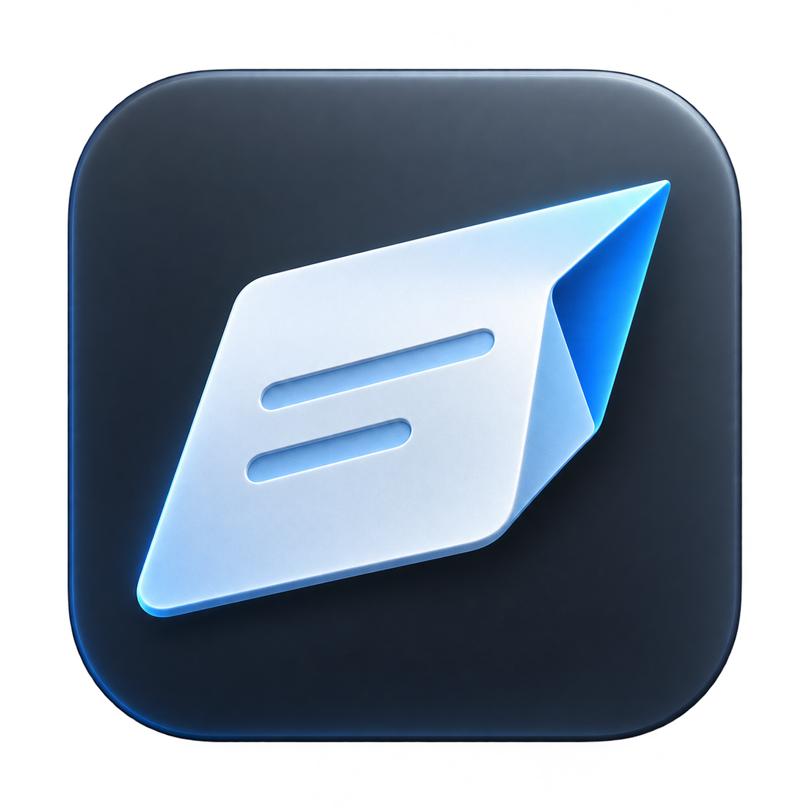

<p align="center"></p>

<h1 align="center">Jotway</h1>

<p align="center">
  <strong>Stop switching note apps. Bring instant capture, AI thinking assistance, and automatic organization straight to native Apple Notes.</strong>
</p>

<p align="center">
  <strong>English</strong> · <a href="README.zh-CN.md">简体中文</a>
</p>

---

## Why Jotway?

If you have ever hopped from one note app to another—building intricate databases in Notion, tweaking dozens of plugins in Obsidian, and migrating folders back and forth—you know the fatigue: **we spend more time maintaining our note systems than actually thinking.**

Eventually, I came back to **Apple Notes**. It is already on every Mac, iPhone, and iPad, syncs effortlessly, opens instantly, and will never shut down or hold your data hostage.

Yet using Apple Notes for daily thinking still had three frustrating gaps:

1. **Quick capture breaks your flow**: Switching apps, picking a folder, and creating a note takes just enough friction to make a fleeting architectural insight disappear.
2. **Fast notes turn into a graveyard**: Dumping ten quick thoughts a day leaves you with a messy list of untitled, disconnected fragments you never want to read again.
3. **No restrained AI partner**: When I get stuck halfway through an idea, I don't want an AI to generate three paragraphs of generic fluff for me—I want a thinking partner that sharpens my own reasoning, plus a quiet background assistant that groups related fragments automatically.

**So I built Jotway.**

If you are an **INTJ**—or anyone who hates bloated workflows, values cognitive autonomy, and wants structured order without manual housekeeping—Jotway was built with your brain in mind.

---

## What Makes Jotway Different

### ⚡ 1. Zero-Friction Capture (`Quick Note Panel`)
Whether you are coding, reading papers, or in a meeting, press your global shortcut to summon the lightweight **Quick Note Panel** right where you are.
- Hit `Enter`, and Jotway saves your note to Apple Notes in the background while **immediately returning focus to your previous window**.
- Need your draft visible while cross-referencing another window? Detach it into a floating **Temporary Sticky Note** pinned on top, then switch back whenever you are ready to save.

### 🗂️ 2. AI Auto-Naming & Daily Grouping (100% Original Words Preserved)
Capturing fast shouldn't mean creating chaos. With **Daily Grouping** enabled, Jotway quietly organizes your stream of consciousness in the background:
- **Smart Titles**: Automatically generates a clean, scannable title for new notes.
- **Same-Day Topic Grouping**: If your new thought relates to something you already captured today, Jotway appends it to that existing Apple Note under a `### HH:mm` timestamp heading instead of cluttering your folder with duplicates.
- **Never Rewrites Your Voice**: AI routes and titles your notes, but **your original text is preserved word-for-word**.

### 🧠 3. AI That Helps You Think—Never Writes for You
Jotway keeps you as the sole author of your thoughts:
- **`Instant Insight`**: Stuck on a half-formed thought? Click the lightbulb in the footer to get a concise, read-only 1–2 sentence cognitive prompt that surfaces hidden assumptions or trade-offs—nudging your thinking forward without touching your draft.
- **`@` Thinking Templates**: Type `@` in an empty panel to launch structured prompts like **记录想法** (*Capture an idea*: the idea → why it's worth doing → the next step) or **梳理问题** (*Work through a problem*). Move cleanly across fields with `Tab` and `Shift+Tab`.
- **Notes Review & Recent Saved Document**: Pull up your **Recent Saved Document** in a side drawer to edit today's latest note in place, or trigger **Notes Review** to surface related past notes from your Apple Notes folder without leaving the panel.

### 🔒 4. Zero Lock-In: Everything Lives in Apple Notes
Jotway has no proprietary cloud vault. Every note you save goes straight into your chosen Apple Notes folder. If you quit Jotway tomorrow, 100% of your notes remain untouched across all your Apple devices.

---

## Built for Systems Thinkers (and INTJs)

| The Note-App Hamster Wheel | Jotway + Apple Notes |
| :--- | :--- |
| Deciding "which folder, tag, or template?" before writing a single word | **Write first**: Summon in 1 second; background AI handles naming and same-day grouping |
| AI tools that overwrite your rough thoughts with generic AI prose | **Cognitive sovereignty**: `Instant Insight` challenges and sharpens your thinking without rewriting your draft |
| Endless plugin maintenance and migration anxiety | **Native foundation**: Plain Apple Notes storage with zero lock-in and zero upkeep |

---

## Getting Started

Requires **macOS 15** or later. This README describes the current source build; release downloads may differ.

### 1. Set Up Once
1. Choose a global shortcut in the welcome guide.
2. Open **Set Up Notes**, click **Allow Access**, and grant macOS Automation access to Apple Notes.
3. Configure your AI service in **Settings → AI** (activate hosted service or bring your own OpenAI-compatible / Claude API key).

Jotway selects a default Notes folder during setup. You can change it anytime in **Settings → Apps → Apple Notes**. See the [first-use guide](docs/product/first-use.md) for details.

### 2. Capture, Think, and Save
1. **Quick capture**: Press your global shortcut → write what you want to remember (`Shift+Enter` adds a line) → check **Save to Notes** and press **Enter**.
2. **Start with a template**: Type `@` in an empty panel and choose a template (customize or add your own in **Settings → Templates**). Use **Tab** / **Shift+Tab** to move between fields, then press **Enter** to save.
3. **Float while working**: Switch to a **temporary sticky note** to keep your draft visible above other windows; both modes share the same draft.

> Drafts stay in memory while Jotway runs (hide and reopen the panel anytime to continue). Quitting, crashing, or restarting clears unsent drafts.

---

## Your Text and Privacy

- **Typing never calls an AI model.**
- **Explicit AI boundaries**: Configured AI providers are used only for Notes title generation, daily grouping, requested `Instant Insight` prompts, and requested **Notes Review** lookups. A configured fallback may send the same input to a second provider, with separate billing.
- **Local control**: When Local Records is enabled, unsent drafts can be stored on your Mac with a default retention of 90 days. Review capture, export, and deletion controls in [settings](docs/product/settings.md).

---

## Build from Source

Requires Swift 6.2 and the macOS 26 SDK.

```bash
swift build
swift test
./scripts/build-app.sh
```

See the [documentation](docs/jotway.md), [development environment](docs/development/environment.md), and [third-party notices](THIRD_PARTY_NOTICES.md).

## License

GNU General Public License v3.0. See [LICENSE](LICENSE).
